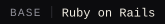
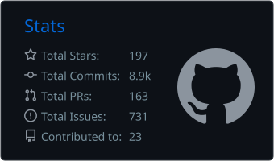
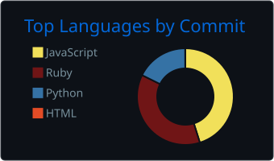

  <picture>
    <source media="(max-width: 600px)" srcset="assets/hero-phone.svg">
    
  </picture>

<b>AI engineer building the context layer for AI coding agents. Senior Ruby on Rails developer.</b>

  
  
  

  
  
  
  

  <a href="#what-i-build"><b>What I build</b></a>&nbsp;&nbsp;&middot;&nbsp;&nbsp;<a href="#open-source"><b>Open source</b></a>&nbsp;&nbsp;&middot;&nbsp;&nbsp;<a href="#shipped-in-production"><b>Production work</b></a>&nbsp;&nbsp;&middot;&nbsp;&nbsp;<a href="#faq"><b>FAQ</b></a>&nbsp;&nbsp;&middot;&nbsp;&nbsp;<a href="#work-with-me"><b>Contact</b></a>

**Cris Nahine** is an AI engineer and senior Ruby on Rails developer. Cris builds developer tools
for AI coding agents: MCP servers, Claude Code plugins and code search that give agents like
Claude Code, Cursor, GitHub Copilot and Codex the real facts about a codebase, so they stop
guessing. Creator of [rails-ai-context](https://github.com/crisnahine/rails-ai-context), a Rails
MCP server listed in the official MCP Registry, and of
[anatomiya](https://github.com/crisnahine/anatomiya), a Claude Code plugin that teaches an agent a
repository's house rules.

## What I build

<table>
<tr>
<td width="50%" valign="top"> <b>Context for agents</b> MCP servers that hand an agent your real schema, models, routes and views, so it reads the app before it writes code.</td>
<td width="50%" valign="top"> <b>Agent plugins and skills</b> Claude Code plugins that learn a repo's own conventions from its code and git history, and check a branch before review.</td>
</tr>
<tr>
<td valign="top"> <b>Code intelligence</b> Search and indexing made for agents: definitions, callers, references and ranked search by meaning.</td>
<td valign="top"> <b>Production Rails</b> Payment, rental and SaaS platforms on Rails, PostgreSQL, Redis and AWS, from first commit to multi-tenant scale.</td>
</tr>
</table>

## Open source

<table>
<tr>
<td width="50%" valign="top">

### [rails-ai-context](https://github.com/crisnahine/rails-ai-context)

Rails MCP server that stops AI coding agents from guessing your app. A Ruby gem with 35 read-only
tools that give Claude Code, Cursor, GitHub Copilot, OpenCode and Codex CLI your real schema,
models, routes, controllers and views. MCP or CLI, and it still answers when the app can't boot.
Listed in the MCP Registry.

</td>
<td width="50%" valign="top">

### [anatomiya](https://github.com/crisnahine/anatomiya)

New to the codebase? So is your coding agent. anatomiya teaches Claude Code your repository's
house rules (where files go, what ships together) from its own code and git history, in nine
languages, and checks a branch before review. Measured: 542 of 560 sessions reused the helper the
repo already had, against 291 of 560 without it.

</td>
</tr>
<tr>
<td colspan="2" valign="top">

### [chameleon](https://github.com/crisnahine/chameleon)

Works out a codebase's conventions from the repo itself and feeds archetype-aware guidance into
AI-generated code: team idioms, banned imports and framework patterns, for TypeScript and
JavaScript, Ruby and Python.

</td>
</tr>
</table>

## Contributions

<table>
<tr>
<td width="33%" valign="top">

**[action_mcp](https://github.com/seuros/action_mcp)** 
Rails engine for the MCP spec. Shipped MCP Apps support (the `renders_ui` DSL), `_meta`
passthrough on resource reads, RFC 9110 405 responses and registry fixes.

</td>
<td width="33%" valign="top">

**[interactor](https://github.com/collectiveidea/interactor)** 
The standard service-object gem for Ruby. Wrote the v4.0.0 proposal that replaces OpenStruct with
a hash-backed Context.

</td>
<td width="33%" valign="top">

**[shoot-the-messenger](https://github.com/theahura/shoot-the-messenger)** 
Auto-unsend for Facebook Messenger. Added facebook.com/messages support, fixed an infinite scroll
loop and moved scraping to stable DOM selectors.

</td>
</tr>
</table>

## Shipped in production

<table>
<tr>
<td width="50%" valign="top">

**[MuliPay](https://mulipay.com)**, B2B payment automation 
Built from the ground up: API-first, multi-tenant, real-time transactions and AI automation
workflows. 
Rails · PostgreSQL · Redis · AWS

</td>
<td width="50%" valign="top">

**[SimpleRent](https://go.simplerent.com.au)**, PropTech platform 
One platform for agencies, landlords and tenants. Led the team, wired up payment gateways,
document automation and AI workflows across several branded subdomains. 
Rails · React · Docker · AWS

</td>
</tr>
<tr>
<td valign="top">

**[airCloset](https://air-closet.com)**, fashion rental 
Online fashion shopping and rental for the Japanese market: clothing categories, subscriptions and
logistics. 
Rails · JavaScript · PostgreSQL · Heroku

</td>
<td valign="top">

**[Craftybase](https://craftybase.com)**, inventory and bookkeeping SaaS 
Senior work for makers and manufacturers: performance tuning, Turbo and Hotwire upgrades,
background job fixes. 
Rails · Hotwire · Sidekiq · Heroku

</td>
</tr>
<tr>
<td colspan="2" valign="top">

**[GoTeam](https://go.team)**, internal tools 
Automated recruitment pipelines, onboarding, network security and productivity tracking, tied
together with OAuth, Zoho and Zapier. 
Rails · Vue.js · Docker · Zapier

</td>
</tr>
</table>

## Stack

  
  
  
  
  
   
  
  
  
  
  
  
  
   
  
  
  
  
  
  
  
  

## Activity

  
  

  <picture>
    <source media="(prefers-color-scheme: dark)" srcset="https://raw.githubusercontent.com/crisnahine/crisnahine/output/github-snake-dark.svg">
    <source media="(prefers-color-scheme: light)" srcset="https://raw.githubusercontent.com/crisnahine/crisnahine/output/github-snake.svg">
    
  </picture>

## FAQ

**Who is Cris Nahine?** 
Cris Nahine is an AI engineer and senior Ruby on Rails developer who builds tools for AI coding
agents. Cris created rails-ai-context, a Rails MCP server, and anatomiya and chameleon, two plugins
that teach coding agents a repository's own conventions.

**What is rails-ai-context?** 
rails-ai-context is an open-source Ruby gem and MCP server for Rails apps. It gives AI coding
agents (Claude Code, Cursor, GitHub Copilot, OpenCode, Codex CLI) 35 read-only tools to look up the
app's real schema, models, routes, controllers and views. It is listed in the MCP Registry.

**What is an MCP server, and why does a Rails app need one?** 
MCP (Model Context Protocol) is the open standard AI agents use to call outside tools. Without one,
an agent guesses column names, routes and associations from file names. A Rails MCP server lets it
ask the app instead, so the code it writes matches the app that exists.

**What is anatomiya?** 
anatomiya is a Claude Code plugin that learns a repository's house rules from its code and git
history, in nine languages, and checks a branch before review. In 560 measured sessions, agents
with it reused the existing helper 542 times; without it, 291 times.

**What does Cris work on?** 
AI developer tooling (MCP servers, agent plugins, code search and code intelligence) and
production Ruby on Rails: payment platforms, PropTech and SaaS, on PostgreSQL, Redis and AWS.

## Work with me

I take on work in AI developer tooling: an MCP server for your app, agent plugins and skills that
fit your team's codebase, and Rails work that has to hold up in production. Reach me on
[LinkedIn](https://linkedin.com/in/cjnahine05) or by [email](mailto:crisjosephnahine@gmail.com).

Every image on this page is drawn by <code>tools/gen_assets.py</code>.

